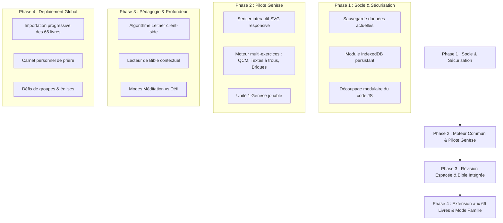

# Synthèse et Analyse Stratégique des Retours ChatGPT
## Projet : De « Défi Jean » au « Grand Pèlerinage de la Bible »

---

### Introduction & Vue d'Ensemble

Les deux liens partagés reflètent deux étapes d'analyse complémentaires fournies par ChatGPT en réponse au rapport d'architecture et de vision (`RAPPORT_PROJET_BIBLE_DUOLINGO.md`) :

1. **Lien 1 (`t_6ad354e019988191be3d89ca7a5119a2`) : L'Architecture Technique & Pédagogique**
   - Répond point par point aux 6 questions architecturales du rapport (organisation en 4 couches, rendu SVG du sentier, modèle unifié des 6 types d'exercices, génération procédurale hybride, algorithme Leitner, et sécurisation de la migration).
2. **Lien 2 (`t_6ad3550099dc81919c70d943cc5b3de1`) : La Vision Produit & les 14 Améliorations Majeures**
   - Dépasse la simple copie de Duolingo pour élever le projet au rang de **Compagnon Quotidien de Croissance Biblique** (Bible intégrée navigable, mode maîtrise réelle, carnet de notes spirituel, triade des modes Méditation / Apprentissage / Défi).

---

## I. Analyse Détaillée du Lien 1 : L'Architecture Technique

### 1. Diagnostic de Maturité & Séparation des Responsabilités
ChatGPT valide la trajectoire PWA mobile-first sans framework lourd (HTML, CSS moderne, JavaScript modulaire, Firebase/IndexedDB), mais insiste sur le fait que **la transition vers les 66 livres ne doit pas consister à créer 66 jeux séparés**, mais un **moteur universel découplé en 4 couches** :

```
┌────────────────────────────────────────────────────────┐
│ 1. INTERFACE UTILISATEUR & SENTIER (UI / SVG)          │
│    Sentier sinueux, jalons, lampes, perles, modales    │
└──────────────────────────┬─────────────────────────────┘
                           │
┌──────────────────────────▼─────────────────────────────┐
│ 2. MOTEUR PÉDAGOGIQUE COMMUN (Core Engine)              │
│    Rendu des 6 exercices, correction, calcul, scoring  │
└──────────────┬──────────────────────────┬──────────────┘
               │                          │
┌──────────────▼──────────┐    ┌──────────▼──────────────┐
│ 3. DONNÉES BIBLIQUES    │    │ 4. DONNÉES DU JOUEUR    │
│    Livres, unités,      │    │    IndexedDB (offline)  │
│    questions validées   │    │    Sync Firestore       │
└─────────────────────────┘    └─────────────────────────┘
```

### 2. Le Sentier d'Apprentissage des 66 Livres (UX & Rendu)
- **Technologie retenue** : **SVG responsive piloté par JavaScript**, préféré à un Canvas WebGL lourd ou à du HTML absolu rigide.
- **Organisation hiérarchique** : `Livre` (ex: Genèse) → `Unités Thématiques` (ex: La Création, Le Déluge) → `Étapes / Jalons` (5 à 7 exercices par session de 3-5 min) → `Jalons Spéciaux` (Révision, Trésor/Perles, Défi de synthèse).
- **Optimisation Mobile** : Virtualisation DOM (ne rendre et animer que les jalons visibles dans le viewport) pour garantir 60 FPS sur smartphones d'entrée de gamme.

### 3. Schéma de Données Unifié pour les 6 Exercices
Un objet JSON universel standardise tous les types d'exercices :
```json
{
  "id": "gen-001",
  "bookId": "genese",
  "unitId": "creation",
  "reference": "Genèse 1:1",
  "type": "word_order", // word_order | matching | who_said | true_false | fill_blank | chronology
  "difficulty": 1,
  "sourceVersion": "LSG1910",
  "prompt": "Reconstitue le verset.",
  "content": {
    "tokens": ["Au", "commencement", "Dieu", "créa", "les", "cieux", "et", "la", "terre."]
  },
  "answer": {
    "orderedTokens": ["Au", "commencement", "Dieu", "créa", "les", "cieux", "et", "la", "terre."]
  },
  "feedback": {
    "explanation": "Ce verset ouvre le récit biblique de la création.",
    "reflection": "Prends un instant pour réfléchir à la place de Dieu dans tes commencements."
  },
  "tags": ["creation", "origines"],
  "validated": true
}
```

### 4. Génération Procédurale Responsable (Garde-fous Théologiques)
Avertissement capital de ChatGPT : **ne jamais laisser un algorithme aléatoire ou une IA non vérifiée fabriquer des faits ou des chronologies bibliques**.
- **Automatisable sans risque** : Variantes d'assemblage de mots (word order), masquage de mots exacts (fill in blanks), reconnaissance de références.
- **Exigeant une validation éditoriale humaine** : Citations (« Qui a dit ? »), événements chronologiques complexes, affirmations théologiques, choix des distracteurs (fausses réponses qui ne doivent pas prêter à confusion doctrinale).
- **Approche retenue** : **Banque Hybride** (Socle certifié + variations mécaniques rigides).

### 5. Algorithme de Répétition Espacée (Modèle Leitner 5 Paliers)
Adaptation locale en JavaScript / IndexedDB :
- **Boîte 0** : Non acquis → Révision immédiate dans la même session.
- **Boîte 1** : Fragile → Révision à J + 1.
- **Boîte 2** : En progression → Révision à J + 3.
- **Boîte 3** : Acquis → Révision à J + 7.
- **Boîte 4** : Bien mémorisé → Révision à J + 14.
- **Boîte 5** : Consolidé → Révision à J + 30.
*Principe clé : L'indice de révision s'applique au verset/concept et non simplement à l'ID de la question, permettant de tester le même passage sous des formats différents (transfert d'apprentissage).*

### 6. Gamification Bienveillante & Migration
- **3 Lampes de la Foi** : Représentent le droit à l'erreur (vies), sans culpabilisation spirituelle.
- **Perles du Royaume** : Monnaie de récompense 100% gratuite (débloque cartes de versets, fonds d'écran, thèmes).
- **Migration & Persistance** : Remplacer la simple fusion `Math.max` par une structure d'historique robuste avec horodatages (`updatedAt`), gérant les résolutions de conflits multi-appareils sans écraser la progression hors-ligne.

---

## II. Analyse Détaillée du Lien 2 : Les 14 Améliorations de Rupture

Le second échange élève le jeu au rang de **Compagnon Biblique d'Édification Quotidienne** grâce à 14 fonctionnalités majeures :

### Les 3 Piliers Phares
1. **La Bible Intégrée & Navigable** :
   - Après un exercice ou en cas d'hésitation, un panneau coulissant permet de lire le chapitre complet dans la version LSG 1910 avec le contexte immédiat.
2. **Mesure de la Maîtrise Réelle** :
   - Une bonne réponse isolée n'est pas considérée comme acquise. Une confirmation différée à 7 et 30 jours valide la mémorisation durable.
3. **Carnet Personnel de Croissance (Journal Spirituel)** :
   - Espace privé où le joueur stocke ses versets favoris, note ses prières ou réflexions issues des exercices, et suit ses livres préférés.

### La Triade des 3 Modes d'Utilisation
| Mode | Objectif | Mécanismes |
| :--- | :--- | :--- |
| **Méditation** | Nourrir l'esprit dans le calme | Sans chrono, sans pénalité de lampes, lecture intégrale du passage, question d'application personnelle |
| **Apprentissage** | Assimiler et mémoriser | Le sentier principal, 6 formats d'exercices, répétition espacée Leitner |
| **Défi** | Se tester et jouer en famille | Chronomètre, scores, étoiles, défis hebdomadaires et ligues amicales facultatives |

### Autres Améliorations Stratégiques
- **Liens Typologiques & Intertextuels** : Relier les prophéties de l'Ancien Testament à leur accomplissement dans le Nouveau Testament (ex: Genèse 3:15 → Apocalypse 12).
- **Mode Famille / Église / Groupe** : Parcours partagé où les scores récompensent l'entraide et l'assiduité plutôt que la pure compétition.
- **Mode Audio & Accessibilité Universelle** : Synthèse vocale pour écouter la Parole dans les transports, compatibilité contraste élevé et lecteurs d'écran.
- **Studio de Gestion de Contenu** : Possibilité d'actualiser et d'enrichir la banque de questions sans recompiler ni redéployer le code de l'application.

---

## III. Matrice de Convergence & Plan d'Action Immédiat

### Comparaison : Nos Fondations vs Recommandations ChatGPT

| Élément | État Actuel (Défi Jean) | Recommandation ChatGPT | Action Immédiate |
| :--- | :--- | :--- | :--- |
| **Technologie** | HTML5 / CSS / Vanilla JS / Firebase | Maintenir sans framework lourd (PWA) | ✅ Conservé & modulaire |
| **Format du jeu** | Quiz chronométré 10 niveaux (QCM) | Sentier sinueux SVG (6 types d'exercices) | 🚀 Phase 2 (Prototype SVG) |
| **Rétention** | Score immédiat | Répétition espacée (Leitner 5 boîtes) | 🚀 Phase 2 (Module `review-engine.js`) |
| **Contenu** | Jean (126 questions) | 66 Livres en unités thématiques | 🚀 Extension progressive (Genèse en pilote) |
| **Bible intégrée** | Références textuelles | Lecteur de chapitre contextuel intégré | 🚀 Ajout d'une modale de lecture fluide |
| **Données joueur** | Firestore + LocalStorage (`Math.max`) | IndexedDB local + Sync Firestore horodatée | 🚀 Audit & refactorisation du stockage |

### Feuille de Route d'Implémentation Recommandée


